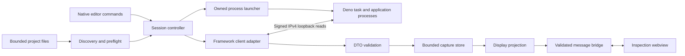

# Extension architecture

Design baseline, 2026-09-22. This document specifies the D01–D04 free preview;
D01 foundation, D02 connection and D03 presentation are implemented with
[local evidence](d02-validation.md) and [D03 validation](d03-validation.md).
D02 and D03 have independent local-scope security reviews; D04 release behavior
is planned. The
[roadmap](../ROADMAP.md) owns feature allocation, the
[contract register](framework-compatibility.md) owns framework facts, and the
[security model](security.md) owns threat cases and acceptance evidence.
Canonical milestone plans will assign individual files and tests before coding.

## Product and runtime decisions

Ship one desktop extension with a native project tree and one inspection panel.
The tree handles selection, launch and connection status. A webview renders the
composition graph and request timeline, with equivalent accessible lists. Use
TypeScript, packaged CSS and SVG/DOM rendering; no frontend framework or graph
engine is needed for the bounded preview. All assets ship inside the VSIX.

The extension manifest declares a Node `main` entry, `extensionKind: ["ui"]`, no
browser entry, no virtual-workspace support, and no untrusted-workspace support.
VS Code distinguishes local Node, remote Node and browser hosts; location
preference alone is insufficient to enforce our support boundary. Check desktop
UI, absent `env.remoteName`, trusted workspace and `file:` roots again in
command handlers. Initially enable launching only on qualified Linux hosts.
[Extension host documentation](https://code.visualstudio.com/api/advanced-topics/extension-host)
and
[virtual workspace guidance](https://code.visualstudio.com/api/extension-guides/virtual-workspaces)
describe these platform mechanisms; the restrictions are our product decisions.

Use a Node/npm development toolchain in this repository, independently of the
framework's Deno toolchain. Bundle the host with esbuild, externalizing
`vscode`, and build the webview separately without Node imports. D01 pins
tooling and records the measured editor/embedded-Node baseline before setting
`engines.vscode`. Do not assume the system Node version is the editor host
version. The
[official bundling guide](https://code.visualstudio.com/api/working-with-extensions/bundling-extension)
documents esbuild integration and retaining the editor-provided `vscode` module.

## Components and dependency direction

The diagram shows data/control flow, not permission delegation. The webview
cannot launch processes, choose endpoints or obtain a framework client.

| Planned area                      | Responsibility and consumer                                                                                                                         |
| --------------------------------- | --------------------------------------------------------------------------------------------------------------------------------------------------- |
| `src/extension.ts`, `src/editor/` | Composition root, commands, tree, panel lifecycle and trust/platform checks; adapts VS Code to application services                                 |
| `src/discovery/`                  | Bounded JSON/JSONC parsing and root/member resolution; produces in-memory project descriptors for the tree and launcher                             |
| `src/session/`                    | One session controller per window, generation tokens, state transitions, deadlines and serialized scheduling                                        |
| `src/launch/`                     | Deno executable resolution, prepared-recipe checks, credential generation, process-group ownership and cleanup                                      |
| `src/diagnostics/`                | Sole importer of the public framework client; injects host crypto/fetch/timers, validates returned DTOs and exposes approved records to the session |
| `src/model/`                      | Pure capture store, graph/timeline projections, loss accounting and bounded filtering; no editor, network or filesystem APIs                        |
| `src/presentation/`               | Allowlisted display messages, page selection, native tree models and fixed UI error codes                                                           |
| `webview/`                        | Rendering and local interaction; imports only browser-safe display contracts                                                                        |
| `test/fixtures/`                  | Synthetic diagnostics and project files for D01/D03; never recorded user traffic                                                                    |

Keep one extension package; these are internal boundaries, not published
packages. Import common DTOs as types from public exports rather than copying
framework interfaces. Define extension-owned display types separately because
they intentionally omit fields. Inject small internal ports for filesystem,
processes, clock, client creation and editor effects into their actual
consumers; do not create unused abstraction layers or a plugin system.

## Discovery and prepared projects

Discovery never runs the CLI, imports `setu.config.ts`, reads `.env`, or
executes workspace dependencies. Begin discovery only when the user opens the
project view or invokes Refresh in a trusted, supported context; thereafter
watch only the discovered roots. Scan each selected workspace folder's known
root files: `setu.workspace.json`, `deno.json`/`deno.jsonc`, and the prepared
entry/task files required for preflight. Members come from the workspace
manifest, not a recursive directory scan. When a root manifest exists, treat it
as authoritative; an invalid manifest must not fall back to standalone
discovery.

Use `jsonc-parser` for Deno configuration and strict JSON mode for the workspace
manifest. Reject parse errors and duplicate keys; never accept the parser's
partial result after an error. Its scanner/visitor supports implementing bounded
depth and duplicate-key checks before building our descriptor.
[Parser documentation](https://github.com/microsoft/node-jsonc-parser).

Resolve canonical local paths and deduplicate roots. For the preview, reject
symlinked manifest/config/entry files and member-directory symlink escapes;
member directories must remain inside their selected root. Revalidate at launch.
Manifest labels are display data, never shell fragments or arbitrary path input.
Map members using the supported CLI layout, `apps/<member>`, with validated
single path segments; unsupported layouts receive migration guidance. Dropping
an invalid member silently would misrepresent the root runner's all-member
launch, so invalidate that root's launch eligibility instead.

Descriptors hold an opaque UI selection ID, canonical root/member identity,
runtime, prepared-task status, application port and optional diagnostics port.
Do not retain arbitrary configuration fields or `transportUrl`. Native UI may
show a user-relative project location; do not send absolute paths to the
webview. File watchers coalesce refreshes, with at most one scan running and one
pending; discovery changes never trigger a launch or replacement session.

Workspace launch requires a selected member with `devtoolPort` and compatible
M98c entries/root runner. Standalone launch requires an explicitly selected
integer diagnostics port (1024–65535); show 4919 as the scaffold default, not a
discovered fact. Keep this selection in memory for the preview. Preflight checks
the prepared files and tasks as text against supported scaffold recipes, without
evaluating TypeScript. Unsupported custom recipes are refused with CLI/manual
migration guidance. A port mismatch can still fail pairing; static checks are
not a proof of arbitrary program behavior.

The Launch command presents the resolved project and execution scope in native
UI before starting it. For a workspace this includes all members, with one
instrumented member. Selection alone is not launch authorization. D02 executes
existing prepared tasks; it does not run `setu devtool enable` or edit files.

## Launch, pairing and ownership

Resolve a real Deno executable from the host PATH or a user-level absolute-path
setting; ignore workspace overrides and exclude relative/PATH-current-directory
resolution. Use `spawn(executable, ['task', 'dev'], ...)` with `shell: false`
and the validated root as `cwd`. This avoids constructing a shell command, but
the Deno task itself executes workspace code with the application's permissions.
Trust and explicit launch remain required. Bundled extension code never imports
the application's packages into the extension host.

For each launch generate a fresh 16-byte session ID and 32-byte key with host
cryptographic randomness. Copy the ordinary host environment, remove inherited
`SETU_DEVTOOL_*` handoff variables, then set the fresh ID/key and, only for a
workspace, its validated member selector. Do not load project env files into the
extension. The M98c runner forwards credentials only to the selected member. The
application still controls its own environment loading after launch.

The host keeps a dedicated key buffer for the lazy-importing client until its
first call settles, then zeroes that buffer; on earlier teardown zero it too.
Release launch handoff references after use; the controller clears its owned
key bytes and drops its strings when the first client call settles or setup fails.
JavaScript strings, child environments and framework copies cannot be promised
erased.

D02's [connection plan](../plans/d02-connection.md) refines the Linux launcher:
a packaged supervisor is the detached process-group leader and starts Deno in
that group. It remains alive after the application root exits and signals only
its own current group; the parent never escalates against a remembered PID.
The launcher retains its handle and does not call `unref()`.
Ignore stdin/stdout/stderr for the preview:
arbitrary application output is neither captured nor persisted as extension
logs. Native status reports fixed launch/connection errors and child exit codes.
An application log viewer requires a later explicit design; do not hide
credentials with an unproven general-purpose log redactor. Node documents that
detached processes on non-Windows hosts form a new process group/session and
that killing a child does not necessarily kill its descendants.
[Node child-process reference](https://nodejs.org/api/child_process.html).

Before spawning, check only the selected loopback port for an existing listener
and refuse if occupied. After spawn, wait at most 60 seconds for TCP acceptance
at that same endpoint, one probe at a time, at 250 ms intervals with a 500 ms
per-probe timeout, while monitoring child exit and cancellation. Close every
probe without sending credentials or protocol requests. This is a readiness
hint, not authentication or a claim of port ownership; the preflight check has a
race and cannot reserve the application's port.

On acceptance create exactly one framework client and call `snapshot()` once; it
owns signed status pairing. The connection becomes live only after that call
passes DTO/identity validation. Application readiness is separate: show snapshot
state such as `starting` or `running`. If initial pairing fails, tear down the
launch and discard credentials. Retry means a new explicit launch, never a new
client using the failed pair. D02 must exercise delayed startup and
wrong-process port races before this strategy is accepted.

Start the extension's 15-minute host timer before supervisor launch, including
startup in the local limit; this can end before the server's TTL. Call it a local session limit, not
server expiry. Support the default M98c TTL only in the preview. No
auto-renewal, automatic restart, attach-to-existing-process, URL setting or port
scanning.

## Session state and teardown

| State            | Entry/exit behavior                                                                                                                  |
| ---------------- | ------------------------------------------------------------------------------------------------------------------------------------ |
| Idle             | No process/client/records. Discovery and selection are allowed                                                                       |
| Preparing        | Check trust, platform, recipe, launch scope and occupied port; no credentials before launch is chosen                                |
| Starting         | Spawn owned process group, start lifetime timer and bounded TCP wait                                                                 |
| Pairing          | One helper snapshot call; no UI diagnostics before validation                                                                        |
| Live             | One scheduler for snapshots/events; display application state independently                                                          |
| Stopping         | Invalidate callbacks, close client, cancel timers/probes, erase capture/view, terminate owned group                                  |
| Failed           | Cleanup completed; retain only fixed reason and exit code, never diagnostic records. Explicit launch may start again                 |
| Cleanup required | Group cleanup could not be confirmed; retain only cleanup ownership metadata, block another launch and show manual recovery guidance |

Every asynchronous operation carries a session generation. Teardown advances it
before awaiting anything; old responses, watcher results and UI messages cannot
repopulate a new session. All stop paths share one idempotent cleanup operation.
Concurrent launches are rejected; switching project requires stopping the active
session first. A second editor window owns a separate launch and receives an
occupied-port error rather than attaching to this window's session.

Disconnect means **stop application and clear capture**, including all members
started by a workspace runner. Apply it on deadline, connection/validation
failure, owned root exit, selected folder removal, extension deactivation and
editor shutdown when disposal runs. The supervisor sends SIGTERM to its own
group, waits up to five seconds, then sends group SIGKILL if necessary; the
parent has two more seconds for read-only disappearance confirmation.
Root exit alone is not cleanup evidence. Never kill by port,
process name, an arbitrary PID from a manifest, or persisted PID after restart.

The supervisor retains group identity while it is alive; its group-relative
signals avoid a parent check-then-kill PID reuse race. Unexpected supervisor
loss, unverifiable membership or surviving processes cause Cleanup required,
never a signal to a possibly replaced process. Linux `/proc` inspection is bounded. Real host, root-exit and
escalation tests are recorded in the D02 validation evidence. Cleanup required blocks another launch until read-only checks confirm
no live remainder. This is local Linux evidence, not a crash-proof or cross-platform guarantee.

Applications that deliberately detach descendants are outside the supported
recipe. A forced host/editor crash may leave application processes running;
server TTL bounds diagnostic access, not application lifetime. No silent
recovery or reattachment occurs on reload. Document this limitation and exercise
it; a crash-proof supervisor is not supplied by M98c.

Hiding or closing the inspection panel stops panel updates and disposes its
rendered data, but leaves the explicit session running under its deadline.
Native status keeps a Stop command visible. Reopening rebuilds a view from
bounded host memory. Clear capture empties retained events, selections and panel
data without rewinding the event cursor or removing the current topology. It is
not server-side deletion: in-flight/backlogged unseen events may arrive after
Clear. Advance a capture revision so older UI replies cannot undo the clear.

## Polling, validation and capture limits

One scheduler owns every helper call: initial snapshot, event reads and topology
refreshes. Poll events with limit 128, at least 250 ms after the preceding call
settles; refresh snapshots at most every five seconds in the same queue. Do not
enqueue timer ticks while busy. A generic helper failure ends the session, using
neutral wording rather than claiming expiry or an authentication error. D02 can
later change this policy only with measured, typed failure contracts.

Validate returned records against supported common types and protocol limits.
Reject incompatible versions, invalid enums/fields, oversized collections,
duplicate graph IDs, invalid numbers and impossible cursor advancement. Require
strictly ordered event sequences above the requested cursor and a consistent
`next`/`lost` result. An event parent or node missing from retained history/topology is
an unresolved reference; topology edge validation remains the helper
contract and is not relaxed. Terminal closed batches
must retain the requested cursor as the framework specifies.

A validated `closed: true` batch ends polling and triggers the same stop path;
do not keep requesting an empty closed reader.

The pinned public helper now binds response headers and DTO identities to the
paired instance, validates exact core schemas and returns deeply frozen values.
D02 requalified those fixes with signed adversarial tests. The extension owns a
fresh allowlisted frozen projection with its own session and retention budgets;
it does not duplicate private framework validators. Unknown wire fields are
rejected by the helper. Never forward raw results to UI or a logger.

The following are extension policy limits, separate from framework bounds.
D01–D03 must implement boundary/overflow tests before claiming them. Byte counts
are UTF-8 input or serialized-model counts, not claims about exact JavaScript
heap use.

| Resource              | Preview policy                                                                                                                  |
| --------------------- | ------------------------------------------------------------------------------------------------------------------------------- |
| Discovery             | At most 16 selected roots and 64 members per root; 256 KiB per input file, nesting depth 32; reject over-limit roots explicitly |
| Discovery concurrency | One scan, one coalesced follow-up; watchers debounce 250 ms                                                                     |
| Sessions/helper calls | One session and one outstanding helper operation per window                                                                     |
| Topology              | One current snapshot within framework's 1,024-node/4,096-edge/256-KiB limits                                                    |
| Retained events       | Evict oldest at 4,096 events or 4 MiB serialized event data, whichever is first; indexes bounded by retained records            |
| Display pages         | At most 100 events or 100 nodes plus 200 edges; label clipping and pagination report omitted content                            |
| Host-to-webview       | At most 256 KiB per message; two updates/second, one unacknowledged frame plus one coalesced replacement                        |
| Webview-to-host       | At most 8 KiB, nesting depth 8, 20 messages/second with burst 20; filter text at most 256 characters, literal matching only     |
| Render stall          | Stop updates after five seconds without frame acknowledgement; recreate the panel on explicit reopen, never queue history       |

Track framework `lost`, framework `droppedEvents`, extension evictions and UI
page clipping separately. Counter discontinuity is unknown/reset, not a negative
loss. Indexes and timeline parent links are pruned with eviction; cap traversal
by the retained record count and tolerate cycles defensively. Keep late parents
and missing parents visible as partial capture. Durations stay inclusive,
nullable timings stay unknown, and streaming response production is not full
stream time.

## Presentation protocol

Use a versioned discriminated message union shared only by host presentation and
webview code. Each panel gets an opaque generation distinct from credentials and
framework instance identity. Reject wrong generations, unknown message kinds,
extra command fields, excessive depth/size and identifiers absent from the
current display model. A panel generation prevents stale messages; it is not a
secret or an authentication substitute.

Allowed webview requests are ready/acknowledge, select node/event, change
bounded filters/page, clear capture, stop session, and open documentation by a
built-in topic ID. Launch and project selection remain native commands. The host
maps documentation IDs to exact packaged HTTPS destinations; messages never
supply URLs, filesystem paths, command IDs, scripts or endpoint values. Do not
register a generic command executor or file-reader bridge.

Host frames contain connection/app state, paged display records, capture-quality
counts and fixed errors. Exclude session ID/key, absolute paths, environment,
raw responses and process output. Commit an acknowledged frame atomically; on
generation/capture revision change discard older frames. Dispose/recreate the
panel on Stop/Clear if acknowledgement cannot establish the visible reset, so a
stalled view cannot keep presenting an old capture as current.

Use a fixed HTML shell, bundled script/style assets, a restrictive CSP and text
nodes for all labels. Keep the VS Code bridge private, disable command URIs,
allow local resources only from packaged assets, and do not retain hidden
webview contexts or persist webview state. These mechanisms are documented in
the [webview guide](https://code.visualstudio.com/api/extension-guides/webview);
the exact message and resource budgets above are our design.

## Delivery sequence and verification

| Milestone | Architecture deliverable                                                               | Evidence required                                                                                                                                                     |
| --------- | -------------------------------------------------------------------------------------- | --------------------------------------------------------------------------------------------------------------------------------------------------------------------- |
| D01       | Host shell, trust/platform gates, discovery and synthetic fixtures                     | Parser/path/command tests and an actual Code OSS development-host smoke test                                                                                          |
| D02       | Prepared launch, credential handoff, client adapter, state machine and bounded capture | Real standalone/workspace processes, sibling isolation, wrong-port/slow-start tests, packaged helper import, cleanup and stale-response races; resolve framework gaps |
| D03       | Graph/timeline, accessible lists, filtering, display protocol                          | Malicious-label/IPC tests, capture loss/eviction/late-parent fixtures, CSP and real editor interaction exercises                                                      |
| D04       | Repeatable VSIX and compatibility matrix                                               | Published dependency pins, VS Code and Code OSS install/launch/stop matrix on qualified OS versions; security acceptance evidence                                     |

Use unit tests with injected ports and integration tests against real Deno
processes; neither substitutes for installing the VSIX in both target editors.
The official
[extension testing guide](https://code.visualstudio.com/api/working-with-extensions/testing-extension)
documents a VS Code-hosted test harness; a passing VS Code run alone does not
qualify Code OSS. Write per-file test mapping and exact commands in each
canonical milestone plan. The [D02 evidence](d02-validation.md) identifies the exercised subset;
future UI and release tests remain unqualified.

Local D02 artifacts may use the pinned unpublished framework revision as
recorded in the contract register. D04 needs released-package reproducibility.
Package only production bundles/assets and notices, never fixture captures,
local mappings, source credentials or an automatic downloader. No billing,
licensing, telemetry, recording, account portal or Pro checks enter the free
preview. Later Pro analysis may consume the validated model; it must not bypass
connection or data protections.

Fixture preview is a development/test-only command, visibly marked as sample
data. Do not register it or include its fixture module in the production VSIX.

## Later capability-specific inspectors

The [framework addon assessment](framework-addons.md) records dependencies for
health, queue investigation, configuration provenance, authorization
explanations and distributed tracing. Keep these outside the D01–D04
capture/display schema. The existing adapter/model/presentation boundaries
provide places to add reviewed typed inspectors later; do not build an arbitrary
provider bus now.

A future inspector must advertise a supported schema and explicit availability
through a reviewed authenticated contract. Plugin registration, a package
version or an HTTP error is not feature negotiation. Separate unsupported,
disabled, no-data, stale and collection-failed states from a successful empty
result. Isolate optional collection failures while retaining the core session's
existing authentication/integrity failure policy. Never hide arbitrary health
`data`, config objects, jobs, principals or spans inside M98 labels or unknown
fields.

Multi-app presentation can precede causal tracing. Reconstructing a
cross-service operation requires explicit parent/link evidence, authorized
sessions and honest sampling/clock/coverage semantics; a matching trace ID is
insufficient. This is a later contract requirement, not a reason to enlarge the
free preview now.
